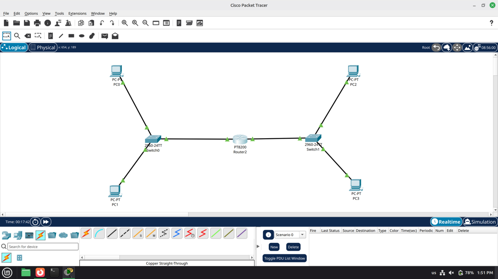
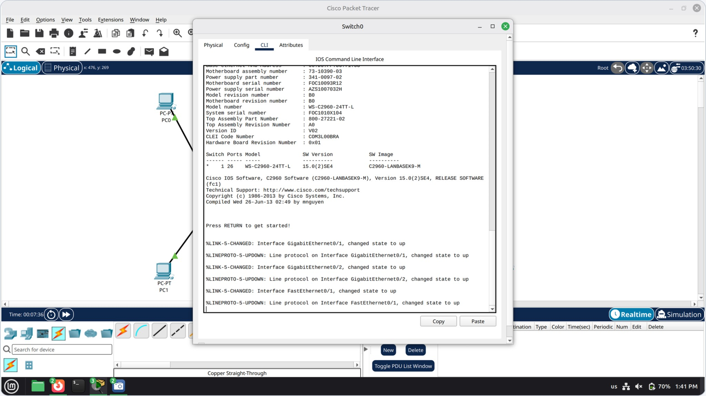
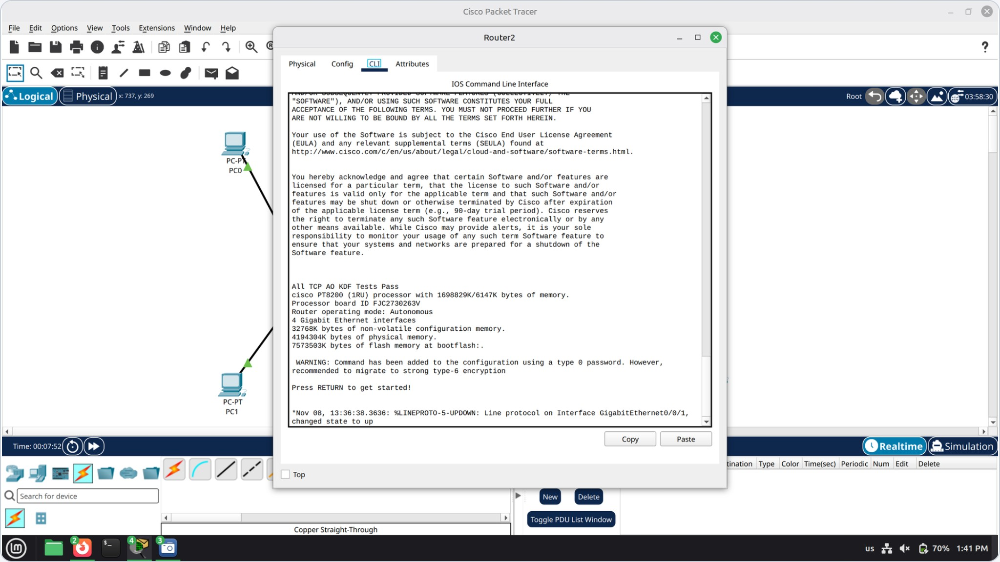
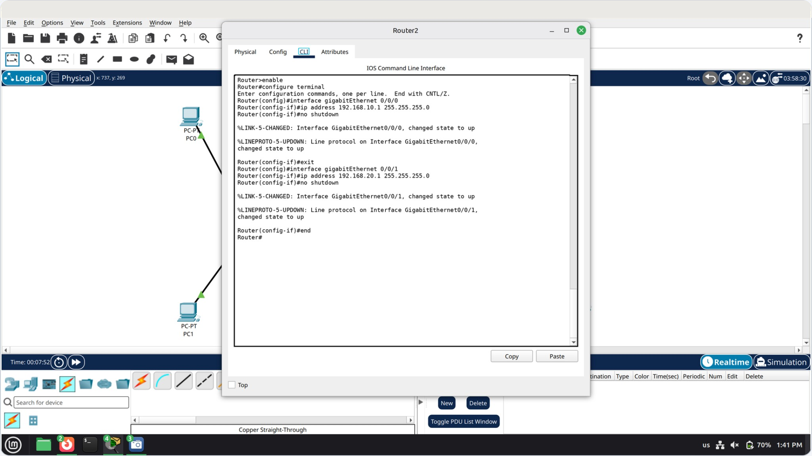
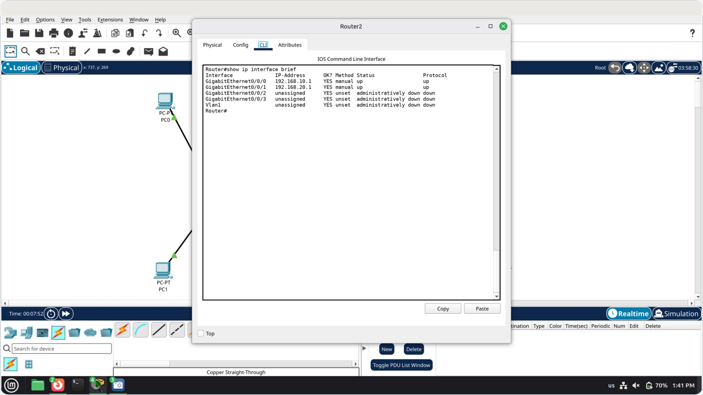
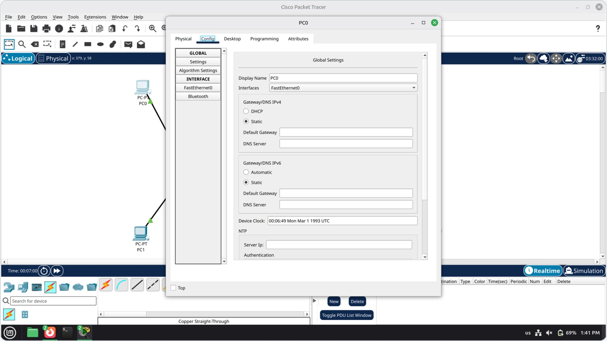
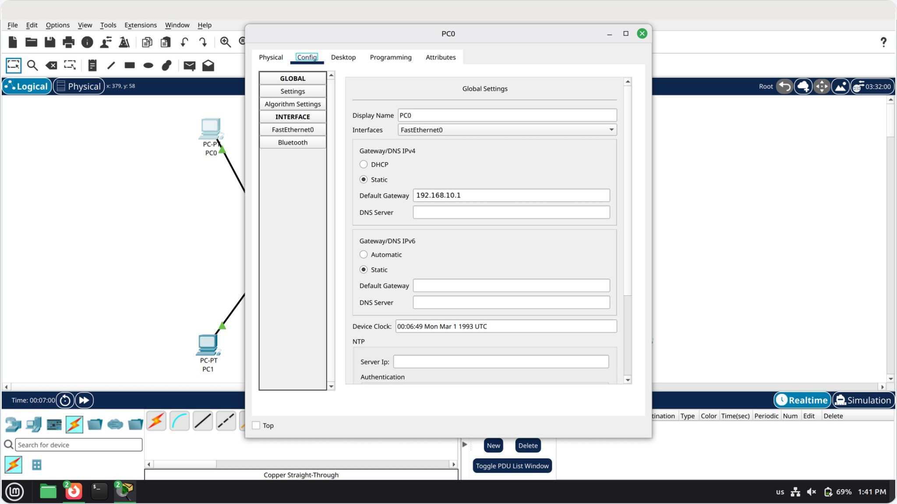
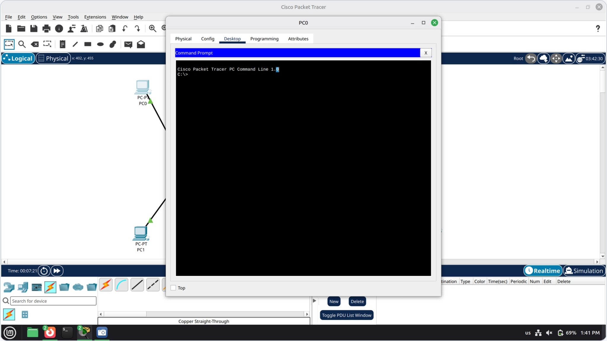
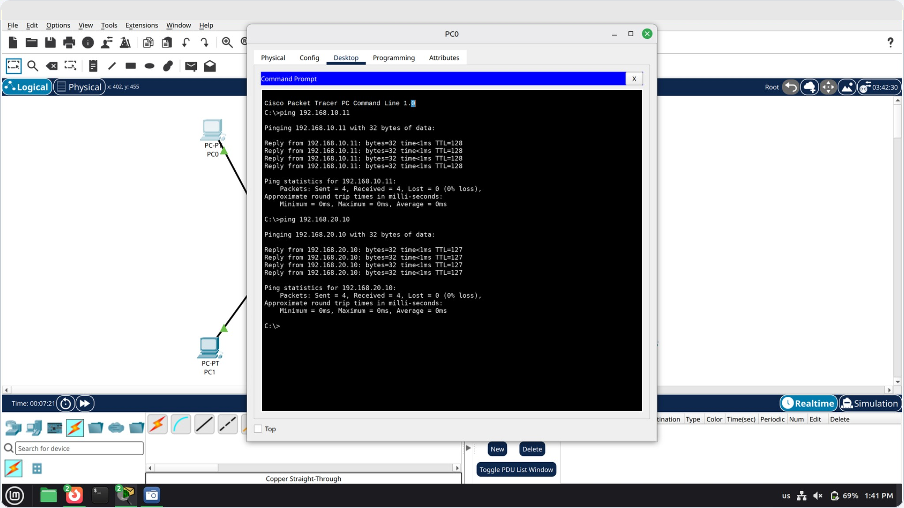
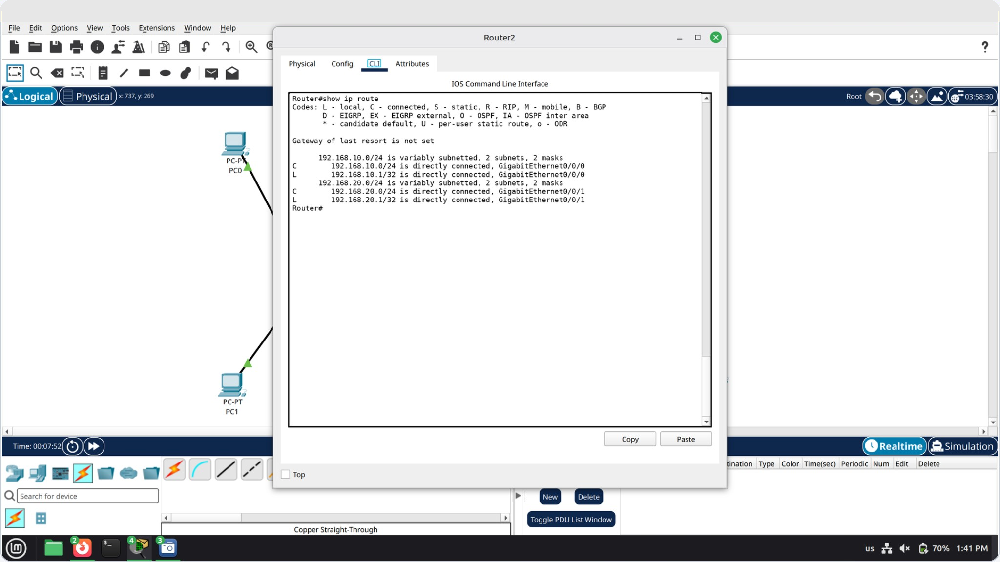

# Packet Tracer Lab: 2 LANs, 1 Router

Two LANs joined by one router in Cisco Packet Tracer. Each LAN has a 2960 switch and two PCs, and the PT8200 router connects the two networks.

## Addressing plan

| Device | Network | IP address | Default gateway |
|--------|---------|------------|-----------------|
| PC0 | 192.168.10.0/24 | 192.168.10.10 | 192.168.10.1 |
| PC1 | 192.168.10.0/24 | 192.168.10.11 | 192.168.10.1 |
| PC2 | 192.168.20.0/24 | 192.168.20.10 | 192.168.20.1 |
| PC3 | 192.168.20.0/24 | 192.168.20.11 | 192.168.20.1 |
| Router2 Gi0/0/0 | 192.168.10.0/24 | 192.168.10.1 | n/a |
| Router2 Gi0/0/1 | 192.168.20.0/24 | 192.168.20.1 | n/a |

Subnet mask on every device: `255.255.255.0`.

---

## Step 1: Build the topology

- **Devices:** PC0 to PC3, two 2960 switches (Switch0, Switch1) and one PT8200 router (Router2).
- **Left LAN:** PC0 and PC1 connect to Switch0.
- **Right LAN:** PC2 and PC3 connect to Switch1.
- **Cables:** Copper Straight-Through, with Router2 between the two switches.
- Orange link dots mean the ports are still converging. Wait until they turn green before testing.



## Step 2: Check the switch links

1. Open **Switch0 → CLI**.
2. The boot log reports link and line protocol `up` on Gi0/1, Gi0/2 and Fa0/1.
3. Model: WS-C2960-24TT-L, IOS 15.0(2)SE4.
4. To see which port goes where, run:

```
show interfaces status
```



## Step 3: Open the router CLI

1. Open **Router2 → CLI** and press Enter at "Press RETURN to get started!".
2. The PT8200 reports 4 Gigabit Ethernet interfaces.
3. Interface names are three-part (`Gi0/0/x`), not `G0/0`.
4. Enter privileged mode:

```
enable
```



## Step 4: Configure the router

Assumes Gi0/0/0 faces Switch0 and Gi0/0/1 faces Switch1. Swap them if your cabling differs.

```
enable
configure terminal
interface gigabitEthernet 0/0/0
ip address 192.168.10.1 255.255.255.0
no shutdown
exit
interface gigabitEthernet 0/0/1
ip address 192.168.20.1 255.255.255.0
no shutdown
end
```

*Expected CLI output:*



## Step 5: Verify the router interfaces

```
show ip interface brief
```

- Both configured ports should read **up / up**.
- `administratively down` means the port still needs `no shutdown`.
- `up / down` usually means the cable or the switch side is not ready.

*Expected output:*



## Step 6: Configure the PCs

On each PC, set the IP address and mask on the **FastEthernet0** page (or **Desktop → IP Configuration**), and the default gateway under **Config → Global Settings**. For PC0, open **PC0 → Config → Global Settings**. IPv4 is set to **Static**, and the gateway and DNS fields start empty.



Use these values:

| Device | IP address | Gateway |
|--------|------------|---------|
| PC0 | 192.168.10.10 | 192.168.10.1 |
| PC1 | 192.168.10.11 | 192.168.10.1 |
| PC2 | 192.168.20.10 | 192.168.20.1 |
| PC3 | 192.168.20.11 | 192.168.20.1 |

The gateway is Router2's address on that PC's LAN.

*PC0 with its default gateway filled in:*



## Step 7: Open the PC command prompt

Open **PC0 → Desktop → Command Prompt**. The first ping can time out while ARP resolves, so run it again.

```
ping 192.168.10.11
ping 192.168.10.1
ping 192.168.20.1
ping 192.168.20.10
ping 192.168.20.11
```



## Step 8: Test connectivity

- **Same LAN:** `ping 192.168.10.11` (PC1) replies with TTL 128.
- **Across the router:** `ping 192.168.20.10` (PC2) replies with TTL 127.
- Four replies and 0% loss means the path works.
- TTL drops by 1 because Router2 is one hop away.

*Expected ping output:*



## Step 9: Why it works

- Switch0 joins PC0 and PC1 in 192.168.10.0/24.
- Switch1 joins PC2 and PC3 in 192.168.20.0/24.
- Router2 joins the two networks.
- No routing protocol is needed because both networks are **directly connected**.

```
show ip route
```

`C` routes are the two LANs, and `L` routes are the router's own addresses.

*Expected route table:*



---

## Commands used

| Where | Command | Purpose |
|-------|---------|---------|
| Switch0 | `show interfaces status` | See port status |
| Router2 | `enable`, `configure terminal` | Enter config mode |
| Router2 | `interface gigabitEthernet 0/0/x` | Select a port |
| Router2 | `ip address <ip> <mask>` | Assign the gateway address |
| Router2 | `no shutdown` | Bring the port up |
| Router2 | `show ip interface brief` | Verify interfaces |
| Router2 | `show ip route` | View the routing table |
| PC | `ping <ip>` | Test connectivity |
