# 2nd Task: Packet Tracer Lab (2 LANs, 1 Router)


Two separate LANs joined by a single router in Cisco Packet Tracer. Each LAN has a 2960 switch and two PCs, and a PT8200 router (**Router2**) connects the two networks and acts as the default gateway for both.

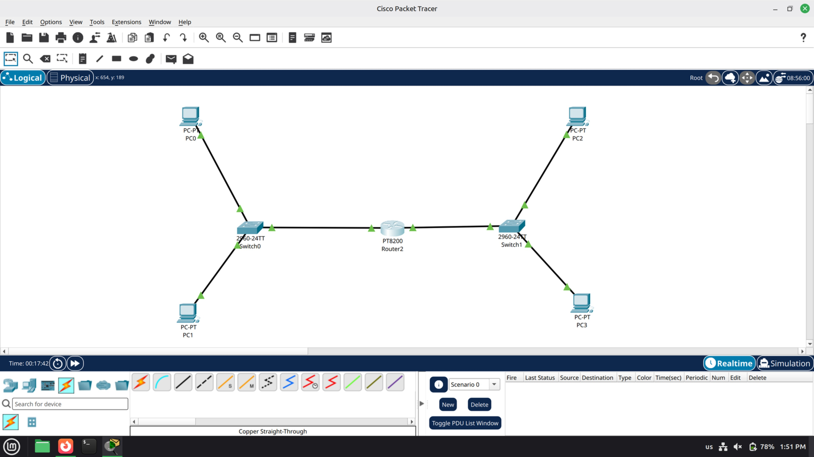

## Table of contents

- [Goals](#goals)
- [Topology](#topology)
- [Addressing plan](#addressing-plan)
- [Quick start](#quick-start)
- [Step-by-step walkthrough](#step-by-step-walkthrough)
- [Results](#results)
- [How it works](#how-it-works)
- [Repository structure](#repository-structure)
- [Further reading](#further-reading)
- [Author](#author)
- [License](#license)

## Goals

- Build a two-LAN topology with two switches and one router.
- Configure two router interfaces as the gateways of their LANs.
- Assign static IP addresses and default gateways on four PCs.
- Prove connectivity inside each LAN and across the router with `ping`.
- Explain why no routing protocol is needed.

## Topology

| Item | Details |
|---|---|
| Devices | PC0 to PC3, Switch0 and Switch1 (Cisco 2960-24TT), Router2 (PT8200) |
| Left LAN | PC0 and PC1 on Switch0, network `192.168.10.0/24` |
| Right LAN | PC2 and PC3 on Switch1, network `192.168.20.0/24` |
| Cables | Copper Straight-Through, with Router2 between the two switches |

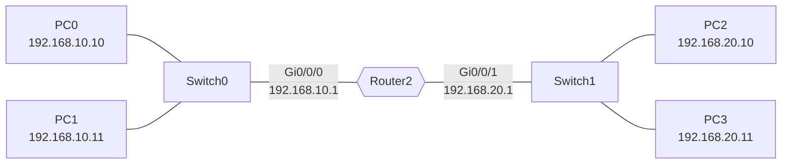

> **Tip:** Orange link dots mean the ports are still converging. Wait until they turn green before testing.

## Addressing plan

Subnet mask on every device: `255.255.255.0`.

| Device | Network | IP address | Default gateway |
|---|---|---|---|
| PC0 | 192.168.10.0/24 | 192.168.10.10 | 192.168.10.1 |
| PC1 | 192.168.10.0/24 | 192.168.10.11 | 192.168.10.1 |
| PC2 | 192.168.20.0/24 | 192.168.20.10 | 192.168.20.1 |
| PC3 | 192.168.20.0/24 | 192.168.20.11 | 192.168.20.1 |
| Router2 Gi0/0/0 | 192.168.10.0/24 | 192.168.10.1 | n/a |
| Router2 Gi0/0/1 | 192.168.20.0/24 | 192.168.20.1 | n/a |

The same plan is available as a file: [`configs/pc-addressing.csv`](configs/pc-addressing.csv).

## Quick start

1. Build the topology in Packet Tracer (see [Step 1](#step-1-build-the-topology)).
2. Open **Router2 → CLI** and paste [`configs/router2.cfg`](configs/router2.cfg).
3. Optionally name each switch with [`configs/switch0.cfg`](configs/switch0.cfg) and [`configs/switch1.cfg`](configs/switch1.cfg).
4. Set the IP address, mask and gateway on each PC using the table above.
5. From PC0, run `ping 192.168.20.10`. Four replies with TTL 127 means it works.

## Step-by-step walkthrough

### Step 1: Build the topology

- **Devices:** PC0 to PC3, two 2960 switches (Switch0, Switch1) and one PT8200 router (Router2).
- **Left LAN:** PC0 and PC1 connect to Switch0.
- **Right LAN:** PC2 and PC3 connect to Switch1.
- **Cables:** Copper Straight-Through, with Router2 between the two switches.


*Figure 1: The finished topology.*

### Step 2: Check the switch links

1. Open **Switch0 → CLI**.
2. The boot log reports link and line protocol `up` on `Gi0/1`, `Gi0/2` and `Fa0/1`.
3. The model is **WS-C2960-24TT-L** running IOS **15.0(2)SE4**.
4. To see which port goes where, run:

```
show interfaces status
```

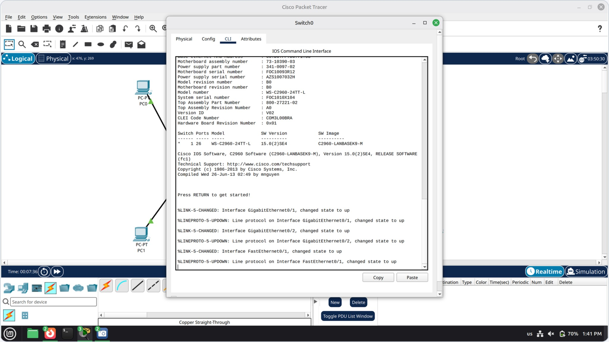

*Figure 2: Switch0 boot log showing the links up.*

### Step 3: Open the router CLI

1. Open **Router2 → CLI** and press Enter at "Press RETURN to get started!".
2. The PT8200 reports **4 Gigabit Ethernet** interfaces.
3. Interface names are three-part (`Gi0/0/x`), not `G0/0` as in older guides.
4. Enter privileged mode:

```
enable
```

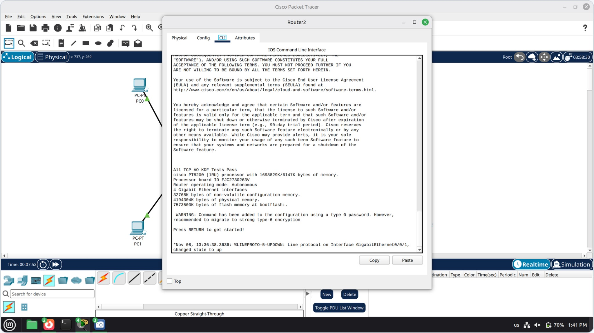

*Figure 3: Router2 CLI after boot. `Gi0/0/1` already reports line protocol up.*

### Step 4: Configure the router

This assumes `Gi0/0/0` faces Switch0 and `Gi0/0/1` faces Switch1. Swap them if your cabling differs.

```
enable
configure terminal
interface gigabitEthernet 0/0/0
ip address 192.168.10.1 255.255.255.0
no shutdown
exit
interface gigabitEthernet 0/0/1
ip address 192.168.20.1 255.255.255.0
no shutdown
end
```

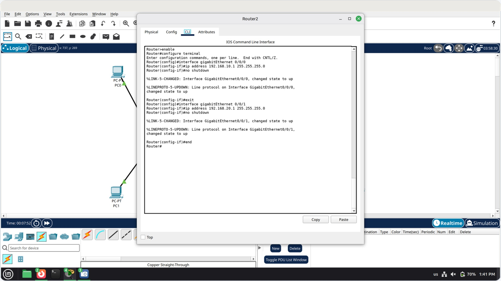

*Figure 4: Router configuration. Each `no shutdown` prints a link-up and a line-protocol-up message.*

**Optional extras** (used in the full config file): give the router a name and label each port.

```
hostname Router2
interface gigabitEthernet 0/0/0
description LAN-Switch0
interface gigabitEthernet 0/0/1
description LAN-Switch1
```

Then save so the configuration survives a reload:

```
copy running-config startup-config
```

### Step 5: Verify the router interfaces

```
show ip interface brief
```

- Both configured ports should read **up / up**.
- `administratively down` means the port still needs `no shutdown`.
- `up / down` usually means the cable or the switch side is not ready.

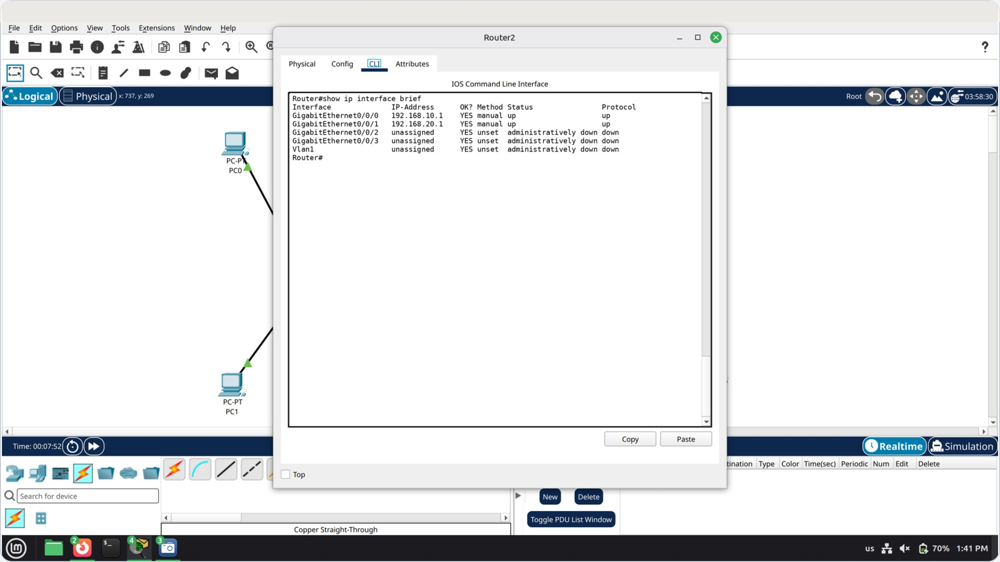

*Figure 5: `Gi0/0/0` and `Gi0/0/1` are up / up. The unused ports stay administratively down.*

### Step 6: Configure the PCs

On each PC, set the IP address and mask on the **FastEthernet0** page (or **Desktop → IP Configuration**), and the default gateway under **Config → Global Settings**. IPv4 must be **Static**. The gateway and DNS fields start empty.

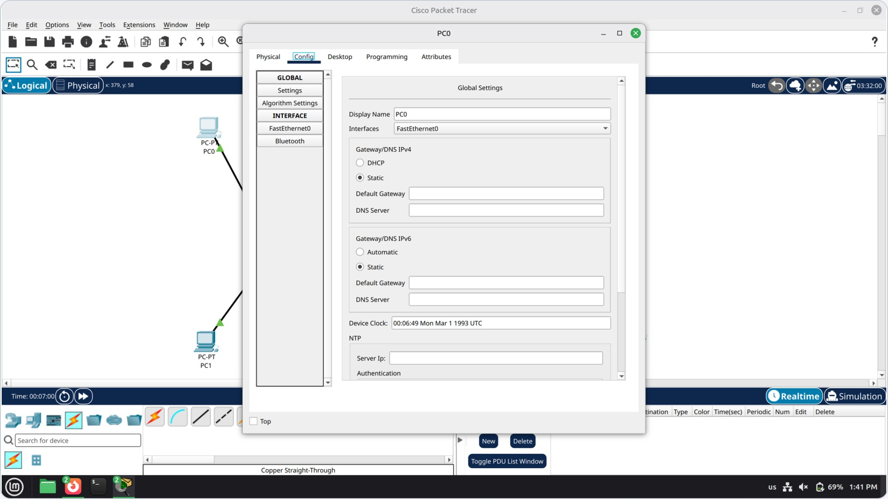

*Figure 6: PC0 Global Settings before the gateway is set.*

| Device | IP address | Gateway |
|---|---|---|
| PC0 | 192.168.10.10 | 192.168.10.1 |
| PC1 | 192.168.10.11 | 192.168.10.1 |
| PC2 | 192.168.20.10 | 192.168.20.1 |
| PC3 | 192.168.20.11 | 192.168.20.1 |

The gateway is Router2's address on that PC's LAN.

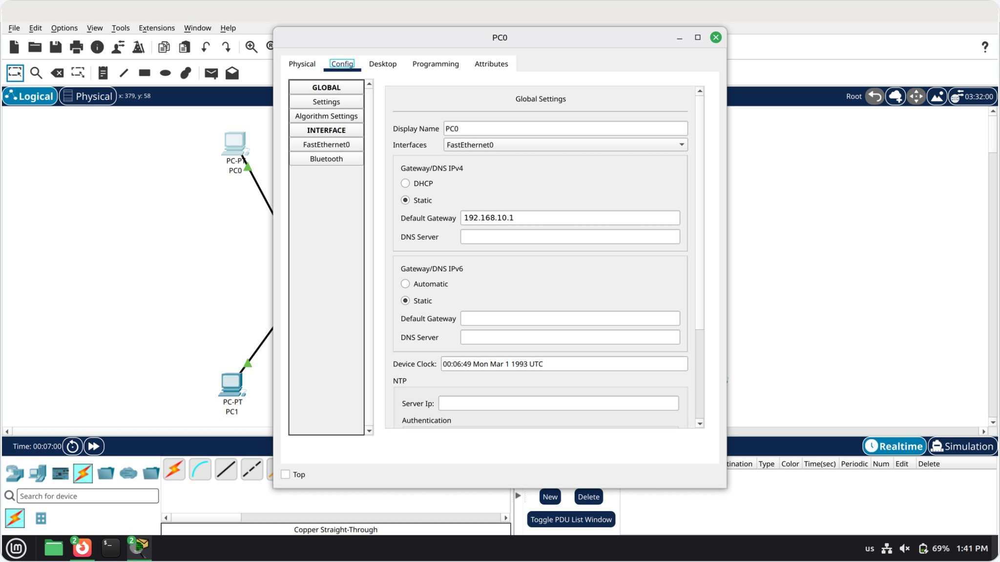

*Figure 7: PC0 with its default gateway `192.168.10.1` filled in.*

### Step 7: Open the PC command prompt

Open **PC0 → Desktop → Command Prompt**. The first ping can time out while ARP resolves, so run it again.

```
ping 192.168.10.11
ping 192.168.10.1
ping 192.168.20.1
ping 192.168.20.10
ping 192.168.20.11
```

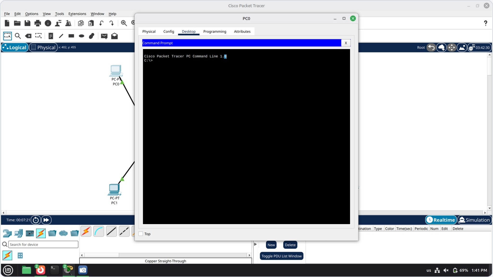

*Figure 8: The PC0 command prompt, ready for the tests.*

### Step 8: Test connectivity

| Test | Command | Expected result |
|---|---|---|
| Same LAN | `ping 192.168.10.11` (PC1) | 4 replies, 0% loss, TTL 128 |
| Across the router | `ping 192.168.20.10` (PC2) | 4 replies, 0% loss, TTL 127 |

Four replies and 0% loss means the path works. TTL drops by 1 because Router2 is one hop away.

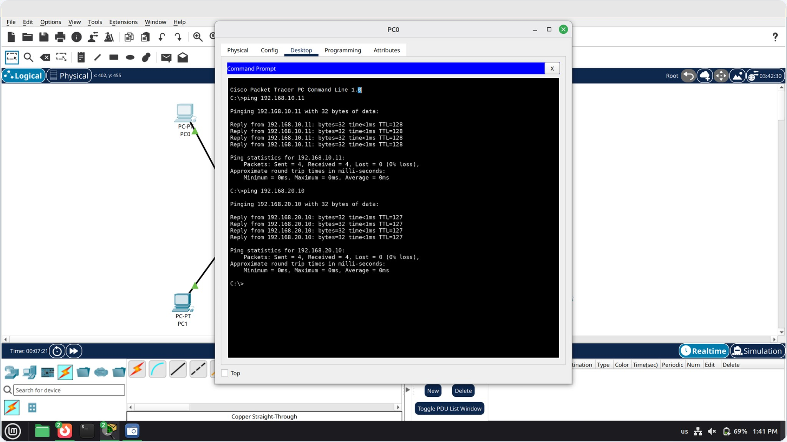

*Figure 9: Ping results from PC0 to PC1 (TTL 128) and to PC2 (TTL 127).*

### Step 9: Why it works

```
show ip route
```

`C` routes are the two directly connected LANs, and `L` routes are the router's own addresses.

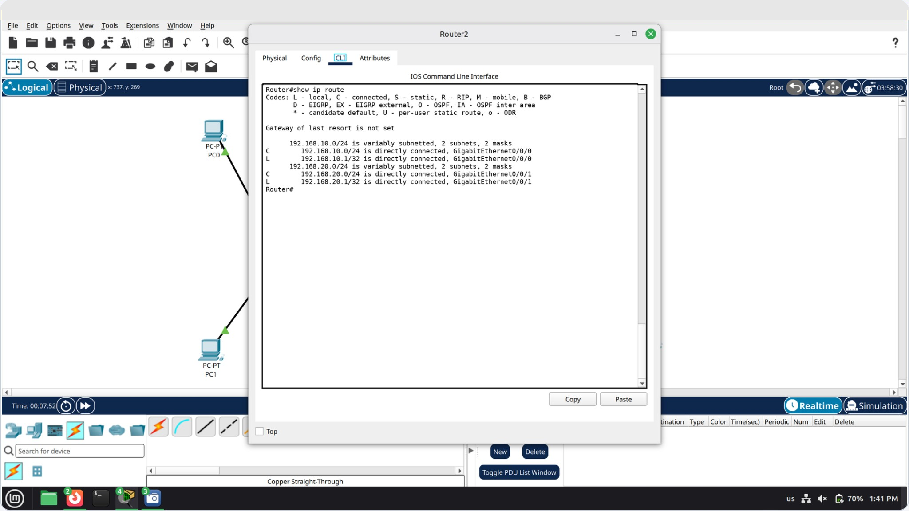

*Figure 10: The routing table on Router2.*

## Results

| Check | Result |
|---|---|
| Topology built and links green | Pass |
| Router `Gi0/0/0` and `Gi0/0/1` up / up | Pass |
| PC addressing and gateways set | Pass |
| Ping inside the LAN (TTL 128) | Pass |
| Ping across the router (TTL 127) | Pass |
| Routing table shows both LANs as connected | Pass |

## How it works

- **Switch0** joins PC0 and PC1 in `192.168.10.0/24`.
- **Switch1** joins PC2 and PC3 in `192.168.20.0/24`.
- **Router2** joins the two networks.
- No routing protocol is needed because both networks are **directly connected** to Router2.

A switch alone cannot join the two LANs. Every port sits in VLAN 1 by default, and one VLAN is one broadcast domain, so each switch gives one subnet. Traffic between subnets has to go through a router. See [`docs/how-it-works.md`](docs/how-it-works.md) for the VLAN, MAC table, ARP and TTL details.

## Repository structure

```
2nd-Task/
├── README.md                  Lab walkthrough (this file)
├── LICENSE                    MIT license
├── configs/
│   ├── router2.cfg            Full Router2 configuration
│   ├── switch0.cfg            Switch0 hostname and save
│   ├── switch1.cfg            Switch1 hostname and save
│   └── pc-addressing.csv      Addressing plan as a table
├── docs/
│   ├── commands.md            Command reference
│   ├── how-it-works.md        VLAN, MAC table, ARP and TTL explained
│   ├── troubleshooting.md     Symptoms, causes and fixes
│   └── 2nd-Task.pdf           Printable submission (A4 landscape)
└── images/                    Screenshots used in this README
```

## Further reading

- [Command reference](docs/commands.md)
- [How it works](docs/how-it-works.md)
- [Troubleshooting](docs/troubleshooting.md)
- [Printable PDF version](docs/2nd-Task.pdf)

## Author

**Mahmoud Basem Ibrahim Ismail**, Faculty of Computers & AI, Al-Ryada University (Group 3S3-Sec).

## License

Released under the [MIT License](LICENSE).
