# 3rd Task: VLAN Configuration Task

Step-by-step screenshot log for the Cisco Packet Tracer VLAN task (`3rd Topo.pkt`). Each step lists what the screenshot shows. Steps 07 to 12 were captured after the ping test, but they are ordered here in the logical configuration sequence.

## Contents

| Step | Screenshot | Topic |
|------|-----------|-------|
| 01 | `01-initial-topology.png` | Initial topology |
| 02 | `02a-...`, `02b-...` | Switch0: VLAN creation |
| 03 | `03-switch0-access-trunk.png` | Switch0: access and trunk ports |
| 04 | `04-switch1-access-trunk.png` | Switch1: access and trunk ports |
| 05 | `05-switch2-trunk.png` | Switch2: trunk ports |
| 06 | `06-router0-subinterfaces.png` | Router0: router-on-a-stick |
| 07 to 12 | `07-...` to `12-...` | PC0 to PC5 IP configuration |
| 13 | `13-pc0-ping-results.png` | Verification: ping tests from PC0 |
| 14 | `14-final-topology.png` | Final topology |

---

## Step 01: Initial Topology

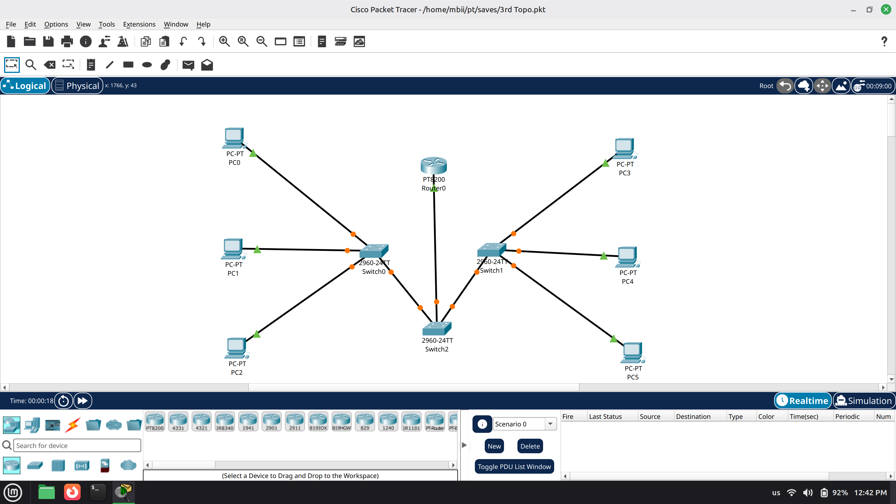

The starting topology in the Logical workspace: Router0 (PT8200), three 2960-24TT switches (Switch0, Switch1, Switch2) and six PC-PT hosts (PC0 to PC5). Switch2 is the central switch connected to Router0, Switch0 and Switch1. PC0 to PC2 connect to Switch0 and PC3 to PC5 connect to Switch1. All links show green status indicators. No VLAN or IP configuration exists yet.

## Step 02: Switch0 VLAN Creation

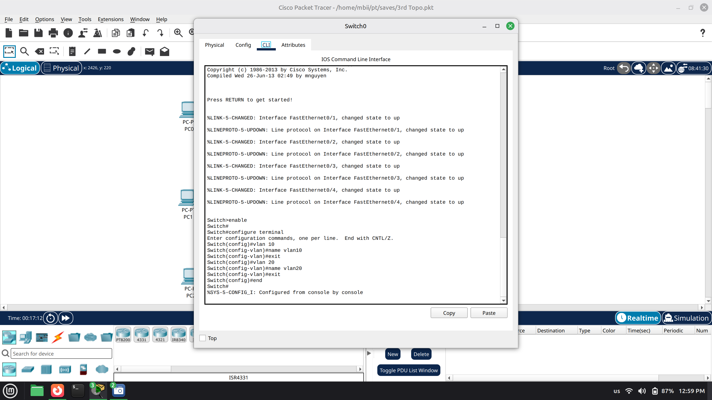

Switch0 CLI. After the startup messages (FastEthernet0/1 to 0/4 come up), VLAN 10 is created with name `vlan10` and VLAN 20 with name `vlan20`. The session ends with `end` and the message `%SYS-5-CONFIG_I: Configured from console by console`.

Screenshot 02a is a wider capture that also includes a browser window beside Packet Tracer. Screenshot 02b shows the same step with only the Packet Tracer CLI, which is the better one to publish.

## Step 03: Switch0 Access and Trunk Ports

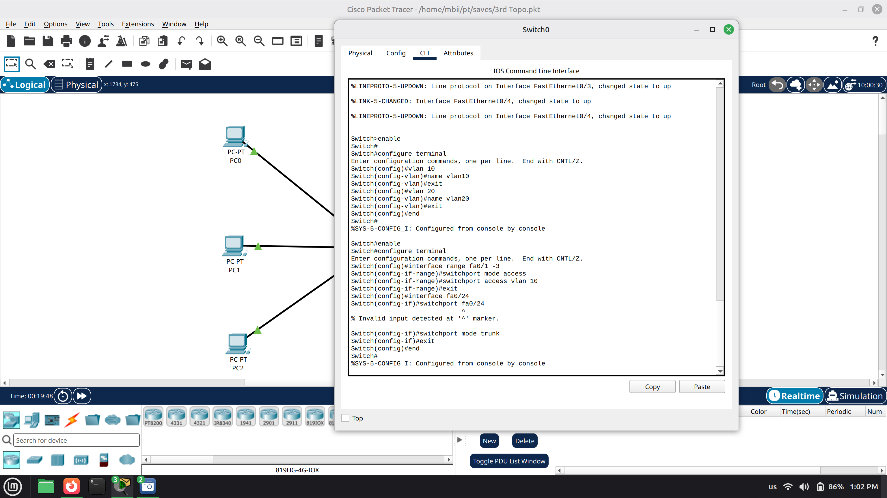

Switch0 CLI. `interface range fa0/1 -3` is set to `switchport mode access` and `switchport access vlan 10`. The command `switchport fa0/24` is rejected with `% Invalid input detected at '^' marker`. `fa0/24` is then set to `switchport mode trunk`.

## Step 04: Switch1 Access and Trunk Ports

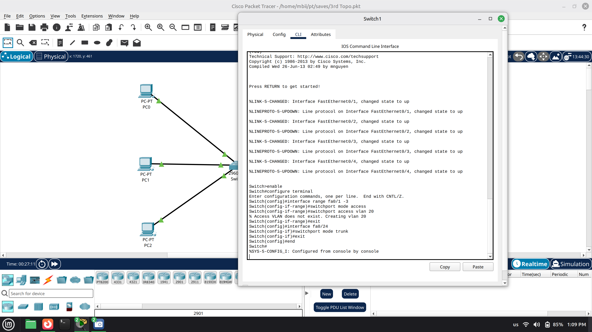

Switch1 CLI. `interface range fa0/1 -3` is set to access mode in VLAN 20. IOS reports `% Access VLAN does not exist. Creating vlan 20` and creates the VLAN automatically. `fa0/24` is then set to trunk mode.

## Step 05: Switch2 Trunk Ports

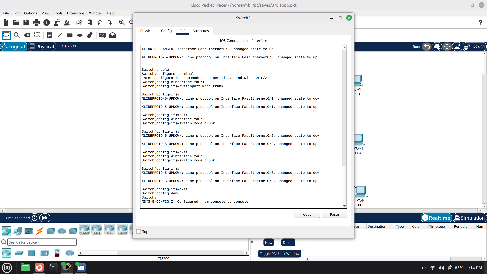

Switch2 CLI. `fa0/1`, `fa0/2` and `fa0/3` are each set to trunk mode. Each change briefly drops the line protocol to down and brings it back up, as shown in the log messages.

## Step 06: Router0 Router-on-a-Stick

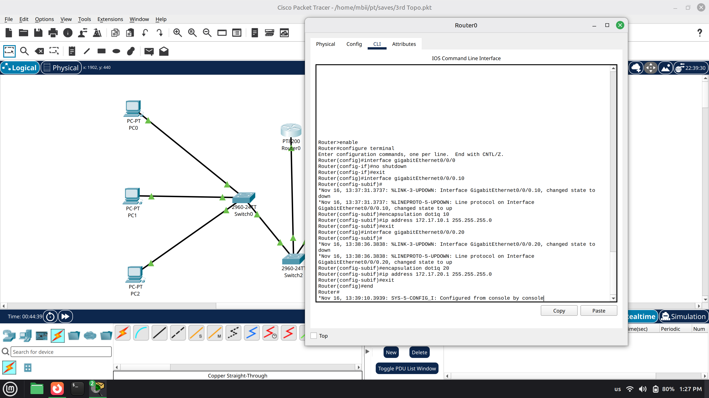

Router0 CLI. `GigabitEthernet0/0/0` is enabled with `no shutdown`. Subinterface `Gi0/0/0.10` is configured with `encapsulation dot1q 10` and `172.17.10.1 255.255.255.0`. Subinterface `Gi0/0/0.20` is configured with `encapsulation dot1q 20` and `172.17.20.1 255.255.255.0`. Both subinterfaces report link and line protocol up.

## Step 07: PC0 IP Configuration

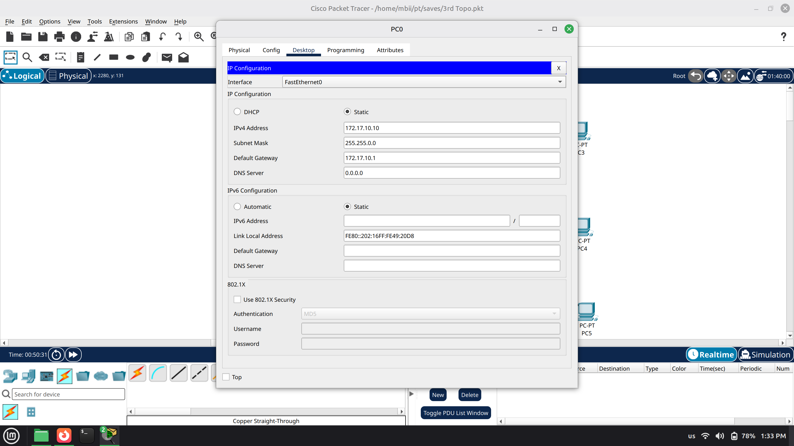

Static IPv4: `172.17.10.10`, mask `255.255.0.0`, gateway `172.17.10.1`, DNS `0.0.0.0`. IPv6 shows only a link-local address.

## Step 08: PC1 IP Configuration

Static IPv4: `172.17.10.11`, mask `255.255.0.0`, gateway `172.17.10.1`, DNS `0.0.0.0`.

## Step 09: PC2 IP Configuration

Static IPv4: `172.17.10.12`, mask `255.255.0.0`, gateway `172.17.10.1`, DNS `0.0.0.0`.

## Step 10: PC3 IP Configuration

Static IPv4: `172.17.20.10`, mask `255.255.0.0`, gateway `172.17.20.1`, DNS `0.0.0.0`.

## Step 11: PC4 IP Configuration

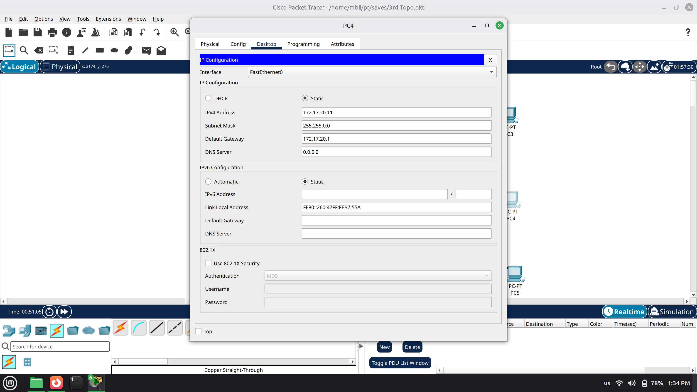

Static IPv4: `172.17.20.11`, mask `255.255.0.0`, gateway `172.17.20.1`, DNS `0.0.0.0`.

## Step 12: PC5 IP Configuration

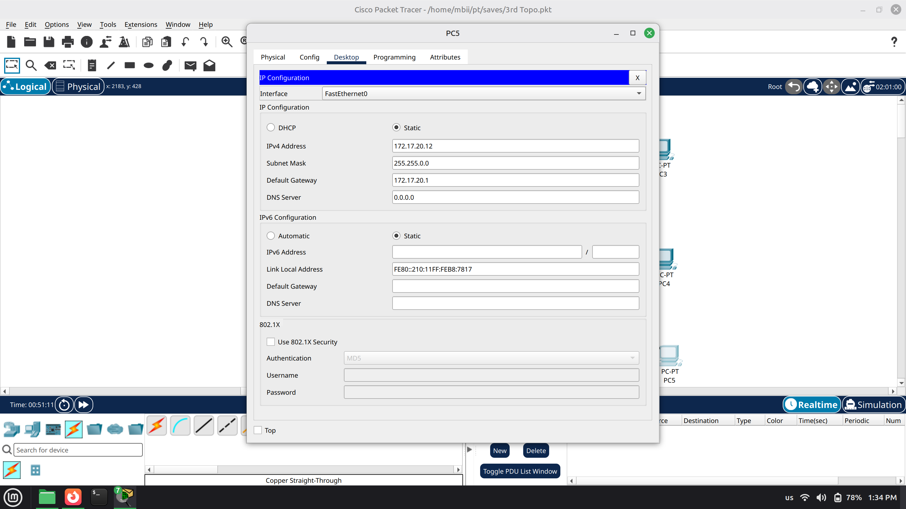

Static IPv4: `172.17.20.12`, mask `255.255.0.0`, gateway `172.17.20.1`, DNS `0.0.0.0`.

## Step 13: Verification, Ping Tests from PC0

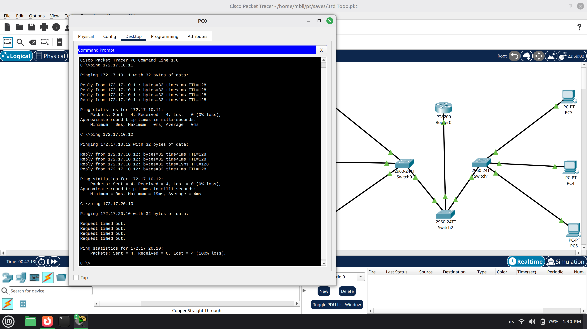

Command Prompt on PC0:

| Destination | Result |
|-------------|--------|
| 172.17.10.11 (PC1, same VLAN) | 4 sent, 4 received, 0% loss |
| 172.17.10.12 (PC2, same VLAN) | 4 sent, 4 received, 0% loss |
| 172.17.20.10 (PC3, other VLAN) | 4 sent, 0 received, 100% loss (Request timed out) |

Same-VLAN connectivity works. The cross-VLAN ping failed. Note that the PCs use mask `255.255.0.0` while the router subinterfaces use `255.255.255.0`, which may contribute to the failure.

## Step 14: Final Topology

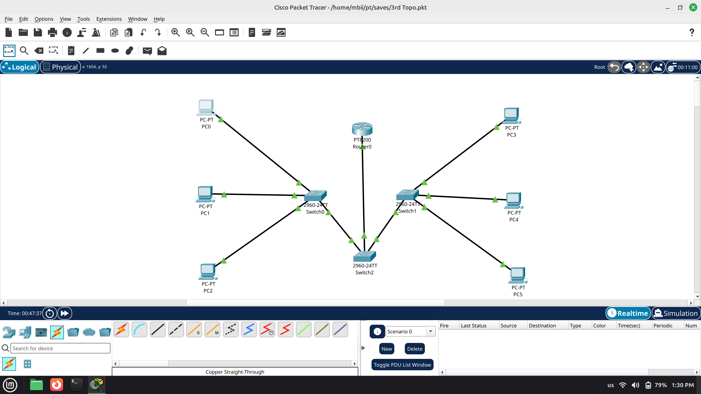

The finished topology after configuration, with all links shown as up.
