# 4th Task: DHCPv4 Configuration

## Objective
Build a small two-LAN network in Cisco Packet Tracer where **one DHCP server (Server0) on LAN1 hands out addresses to clients on LAN2** across a router. This is done with a **DHCP relay agent** (`ip helper-address`) configured on the router.

## Topology

```
                    Router (PT8200, hostname R1)
                  Gi0/0/0 (192.168.1.1)   Gi0/0/1 (192.168.2.1)
                         |                        |
                      Switch0                  Switch1
                         |                  /   |    |    \
                      Server0             PC0  PC1  PC2  PC3
                  (DHCP server)           (DHCP clients)
```

| Device  | Role                         | Network        |
|---------|------------------------------|----------------|
| R1      | Router / DHCP relay          | Gateway for both LANs |
| Switch0 | 2960-24TT                    | LAN1 – 192.168.1.0/24 |
| Server0 | DHCP server (192.168.1.10)   | LAN1 |
| Switch1 | 2960-24TT                    | LAN2 – 192.168.2.0/24 |
| PC0–PC3 | DHCP clients                 | LAN2 |

## Screenshots
All screenshots are in the [`images/`](images/) folder, numbered in the order of the steps below.

---

## Step 1 – Build the topology
*Screenshot: `images/01-topology.png`*

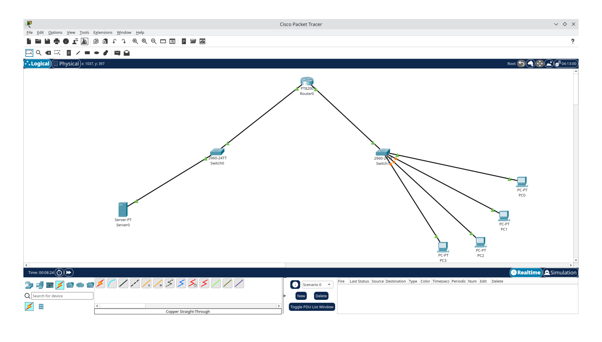


- Place one **PT8200 router**, two **2960-24TT switches**, one **server** and four **PCs**.
- Connect with **Copper Straight-Through** cables: Router ↔ Switch0 ↔ Server0, and Router ↔ Switch1 ↔ PC0, PC1, PC2, PC3.
- Wait for the link lights to turn green (orange = still converging).

## Step 2 – Open the router CLI and set the hostname
*Screenshot: `images/02-router-cli-start.png`*

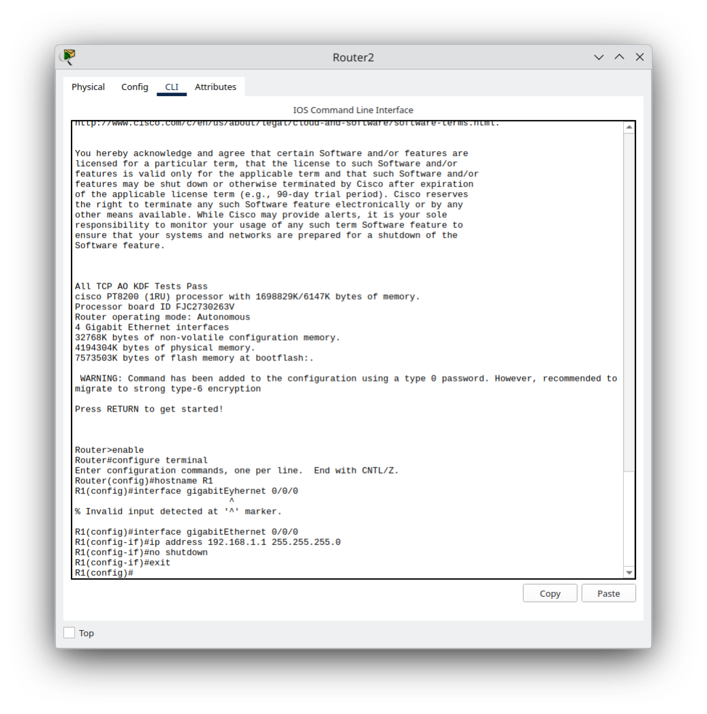


```
Router> enable
Router# configure terminal
Router(config)# hostname R1
```

A typo (`gigabitEyhernet`) produced `% Invalid input detected at '^' marker.` – the `^` points at the exact character that is wrong. The command was retyped correctly.

## Step 3 – Configure the router interfaces and save
*Screenshot: `images/03-router-interfaces-save.png`*

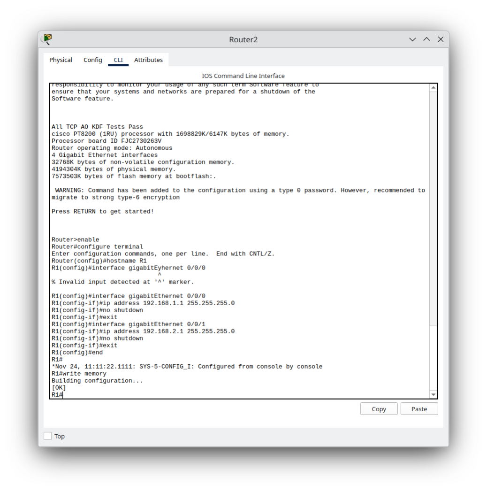


```
R1(config)# interface gigabitEthernet 0/0/0
R1(config-if)# ip address 192.168.1.1 255.255.255.0
R1(config-if)# no shutdown
R1(config-if)# exit
R1(config)# interface gigabitEthernet 0/0/1
R1(config-if)# ip address 192.168.2.1 255.255.255.0
R1(config-if)# no shutdown
R1(config-if)# exit
R1(config)# end
R1# write memory
```

- `Gi0/0/0` = default gateway of **LAN1** (server side).
- `Gi0/0/1` = default gateway of **LAN2** (PC side).
- `no shutdown` brings the interfaces up; `write memory` saves the config to NVRAM (`[OK]`).

## Step 4 – Verify the interfaces
*Screenshot: `images/04-show-ip-interface-brief.png`*

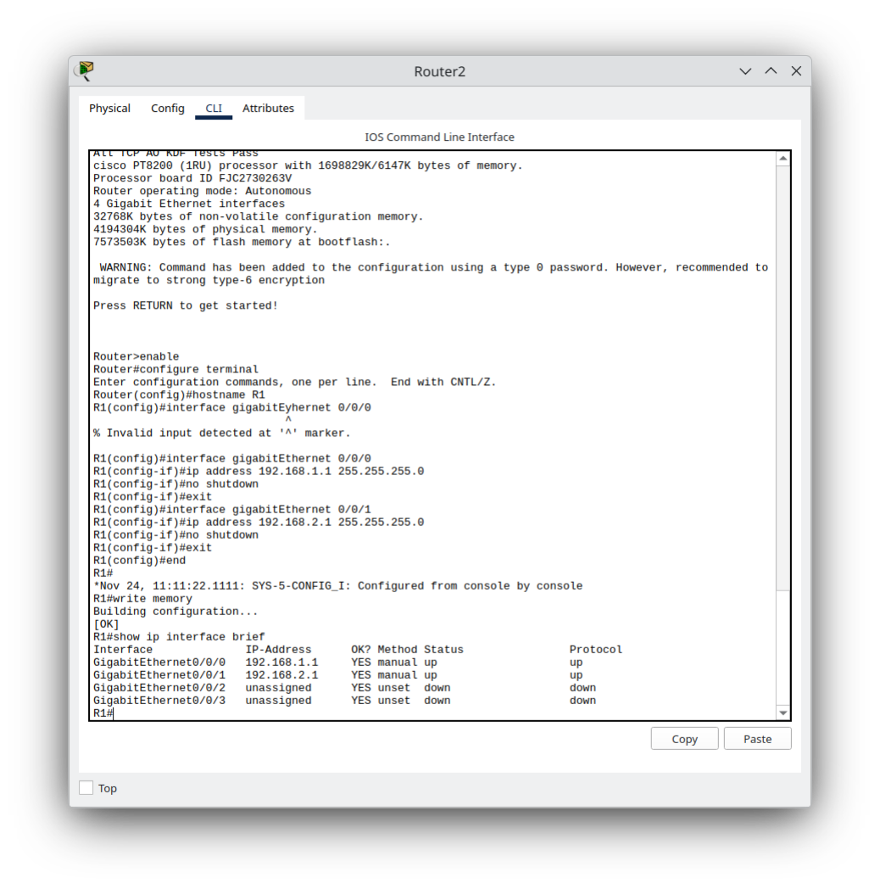


```
R1# show ip interface brief
```

Both `GigabitEthernet0/0/0` (192.168.1.1) and `GigabitEthernet0/0/1` (192.168.2.1) show **Status: up / Protocol: up**. The other two ports are unassigned and down, as expected.

## Step 5 – Configure the DHCP pool for LAN1 on Server0
*Screenshot: `images/05-server-dhcp-lan1.png`*

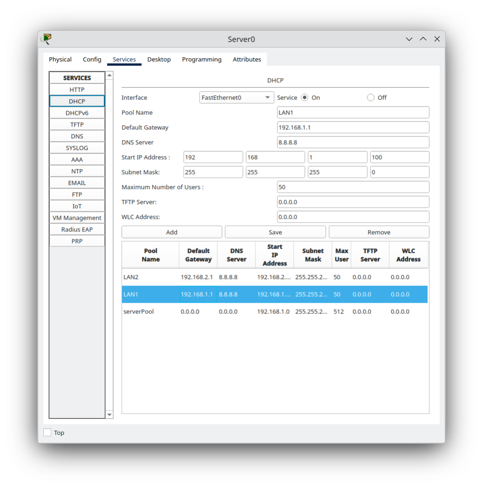


Server0 → **Services → DHCP**, service **On**:

| Field | Value |
|-------|-------|
| Pool Name | LAN1 |
| Default Gateway | 192.168.1.1 |
| DNS Server | 8.8.8.8 |
| Start IP | 192.168.1.100 |
| Subnet Mask | 255.255.255.0 |
| Max Users | 50 |

Click **Add** / **Save**.

## Step 6 – Configure the DHCP pool for LAN2 on Server0
*Screenshot: `images/06-server-dhcp-lan2.png`*

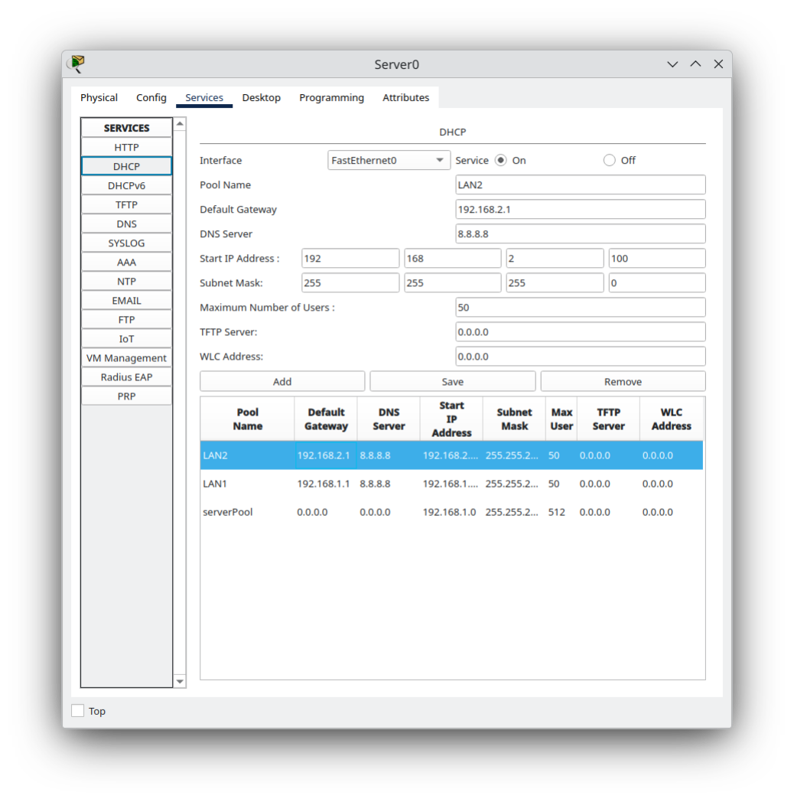


Same screen, second pool:

| Field | Value |
|-------|-------|
| Pool Name | LAN2 |
| Default Gateway | 192.168.2.1 |
| DNS Server | 8.8.8.8 |
| Start IP | 192.168.2.100 |
| Subnet Mask | 255.255.255.0 |
| Max Users | 50 |

The server now holds the pools `LAN1`, `LAN2` and the default `serverPool`.

## Step 7 – Configure the DHCP relay on the router
*Screenshot: `images/07-ip-helper-address.png`*

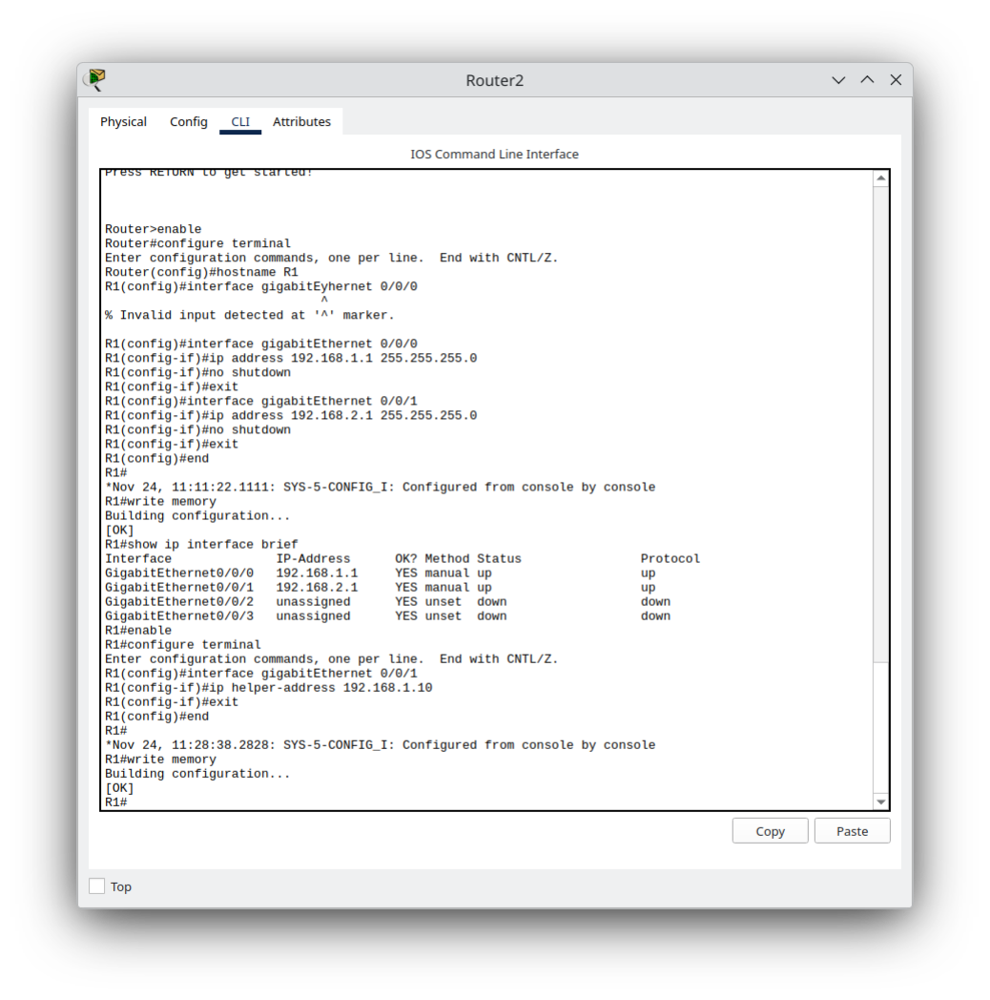


DHCP discovery messages are **broadcasts**, and routers do not forward broadcasts. The server is on a different subnet from the PCs, so the router must relay the requests as unicast to the server:

```
R1# configure terminal
R1(config)# interface gigabitEthernet 0/0/1
R1(config-if)# ip helper-address 192.168.1.10
R1(config-if)# exit
R1(config)# end
R1# write memory
```

The helper address goes on the interface **facing the clients** (`Gi0/0/1`, LAN2) and points at the DHCP server's IP.

## Step 8 – Review the running configuration
*Screenshot: `images/08-show-running-config.png`*

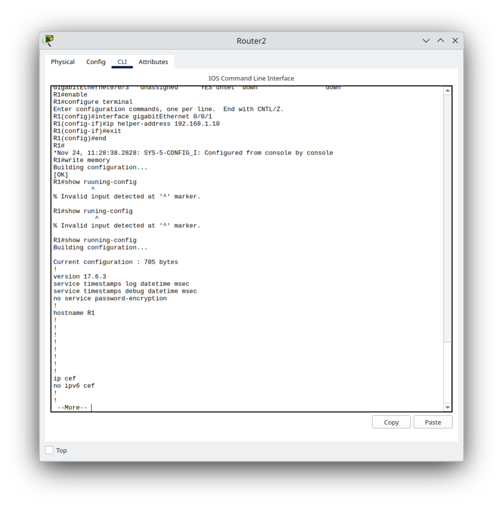


```
R1# show running-config
```

Two typos (`ruuning-config`, `runing-config`) were rejected before the correct command worked. The output shows `hostname R1` and the interface configuration, including the helper address. `--More--` means press Space for the next page.

## Step 9 – Verify DHCP on each PC
*Screenshots: `images/09-pc0-dhcp.png`, `images/10-pc1-dhcp.png`, `images/11-pc2-dhcp.png`, `images/12-pc3-dhcp.png`*


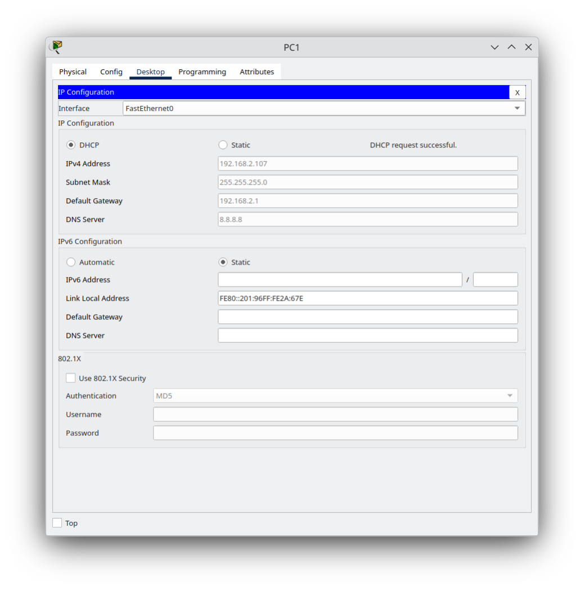


On each PC: **Desktop → IP Configuration → DHCP**. Each shows **"DHCP request successful."**

| PC  | IPv4 Address  | Subnet Mask   | Default Gateway | DNS     |
|-----|---------------|---------------|-----------------|---------|
| PC0 | 192.168.2.106 | 255.255.255.0 | 192.168.2.1     | 8.8.8.8 |
| PC1 | 192.168.2.107 | 255.255.255.0 | 192.168.2.1     | 8.8.8.8 |
| PC2 | 192.168.2.108 | 255.255.255.0 | 192.168.2.1     | 8.8.8.8 |
| PC3 | 192.168.2.109 | 255.255.255.0 | 192.168.2.1     | 8.8.8.8 |

All PCs got addresses from the **LAN2** pool even though the DHCP server sits in LAN1 – proof the relay works.

## Step 10 – Confirm the DHCP server with `ipconfig /all`
*Screenshot: `images/13-pc0-ipconfig-all.png`*

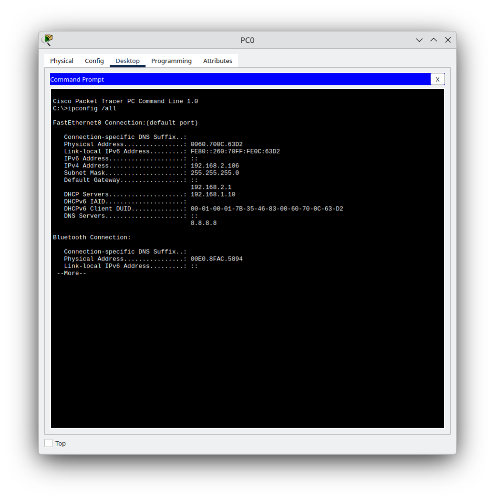


On PC0: **Desktop → Command Prompt → `ipconfig /all`**.

The output shows `IPv4 Address 192.168.2.106`, `Default Gateway 192.168.2.1`, `DNS 8.8.8.8` and **`DHCP Servers: 192.168.1.10`**, confirming the lease came from Server0 through the router.

## Step 11 – Test connectivity with ping
*Screenshot: `images/14-pc0-ping.png`*

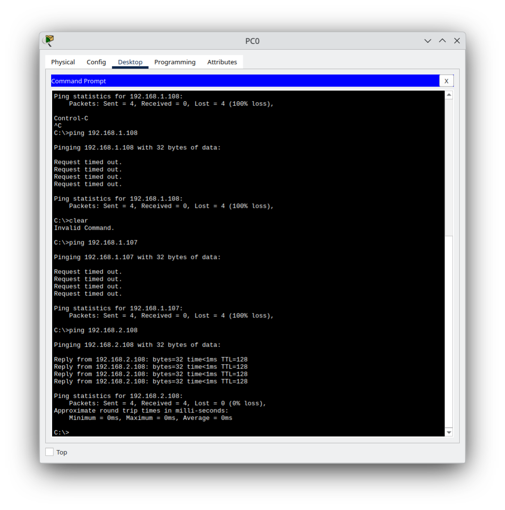


| Test (from PC0) | Result | Why |
|-----------------|--------|-----|
| `ping 192.168.1.108` | 100 % loss | No host has this address – the PCs are in 192.168.2.x, not 192.168.1.x |
| `ping 192.168.1.107` | 100 % loss | Same reason (wrong subnet) |
| `ping 192.168.2.108` | 4/4 replies, TTL=128 | PC2's real DHCP address |

The failures are a wrong-address mistake, not a network fault. Pinging the addresses the PCs actually received succeeds.

## Step 12 – Final topology
*Screenshot: `images/15-final-topology.png`*

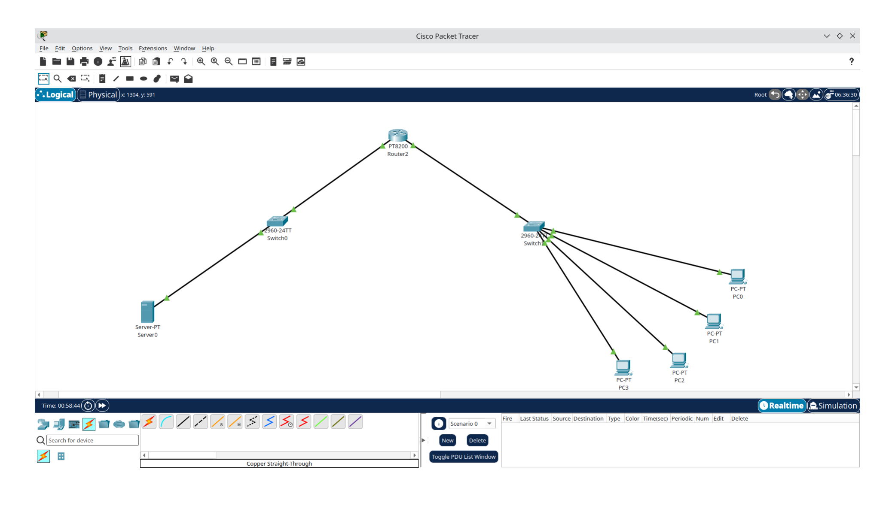


All links are green and every PC holds a DHCP lease. (The router label reads `Router2` in the device window title – same device, hostname `R1`.)

---

## Final configuration summary

```
hostname R1
!
interface GigabitEthernet0/0/0
 ip address 192.168.1.1 255.255.255.0
 no shutdown
!
interface GigabitEthernet0/0/1
 ip address 192.168.2.1 255.255.255.0
 ip helper-address 192.168.1.10
 no shutdown
```

## Key takeaways
1. A router separates broadcast domains, so DHCP across subnets needs a **relay agent** (`ip helper-address`).
2. One DHCP server can serve many subnets by defining **one pool per subnet**, each with its own gateway.
3. Always verify: `show ip interface brief`, `show running-config`, `ipconfig /all`, and `ping`.
4. Read the `^` marker in IOS errors – it points to the mistake.

## Repo contents
```
4th-Task/
├── README.md
└── images/   (screenshots 01–15)
```
